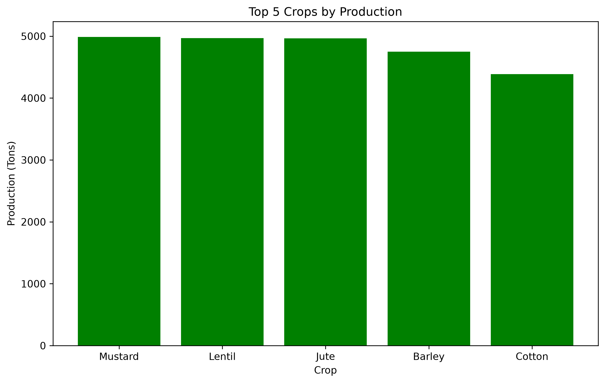
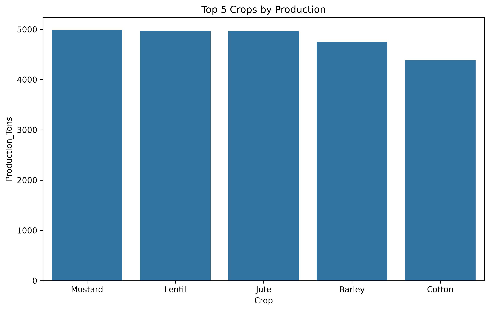

# Agriculture Data Analysis Using Python

## Project Overview
This beginner-level project analyzes agricultural crop data using Python. It explores crop production, cultivated area, rainfall, fertilizer usage, costs, sales, and profit.

**Note:** The current dataset contains randomly generated sample data for learning and demonstration purposes. It does not represent actual agricultural statistics.

## Tools and Libraries
- Python
- Pandas
- NumPy
- Matplotlib
- Seaborn

## Analysis Performed
- Created a dataset containing 20 crops.
- Calculated yield per hectare and profit.
- Classified crops by profit or loss.
- Sorted crops by profitability and production.
- Calculated average, total, highest, and lowest production.
- Grouped crops by category.
- Classified production into High, Medium, and Low levels.
- Visualized the top five crops by production.

## Visualizations

### Matplotlib — Top 5 Crops by Production


### Seaborn — Top 5 Crops by Production


## Project Structure
```text
agriculture-analytics/
├── main.py
├── README.md
└── graphs/
    ├── top_5_crops_matplotlib.png
    └── top_5_crops_seaborn.png
```

## How to Run
1. Install Python.
2. Install the required libraries:
   `python -m pip install pandas numpy matplotlib seaborn`
3. Run the project:
   `python main.py`

## Future Improvements
- Use verified real-world agricultural datasets.
- Analyze crop yield and profitability patterns.
- Add more visualizations and statistical analysis.

## Author
Agriculture Data Analytics Project — Python Portfolio
